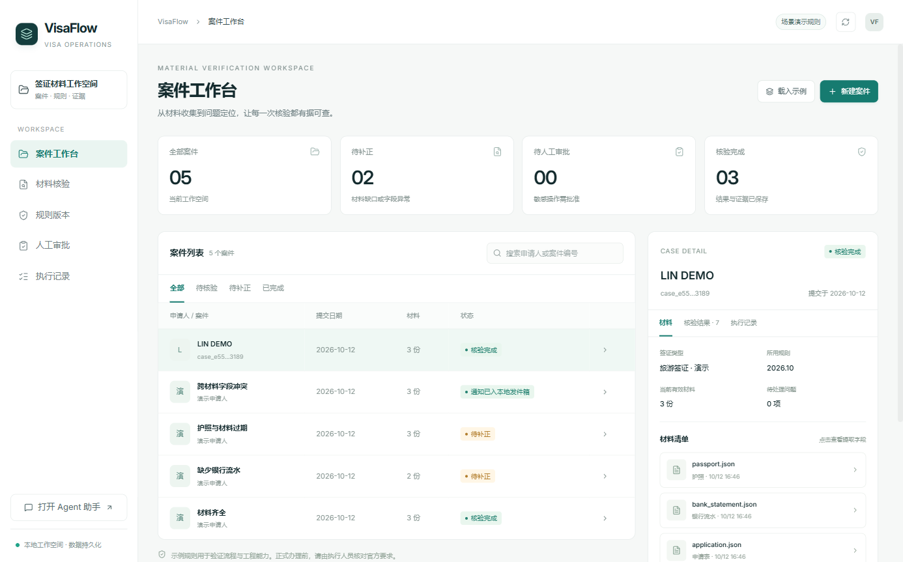
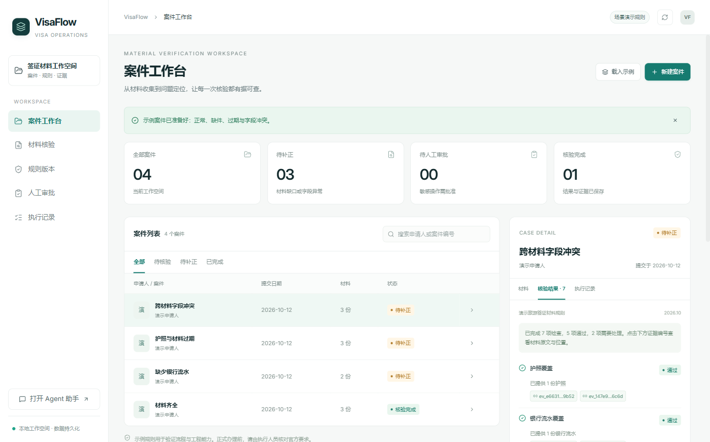
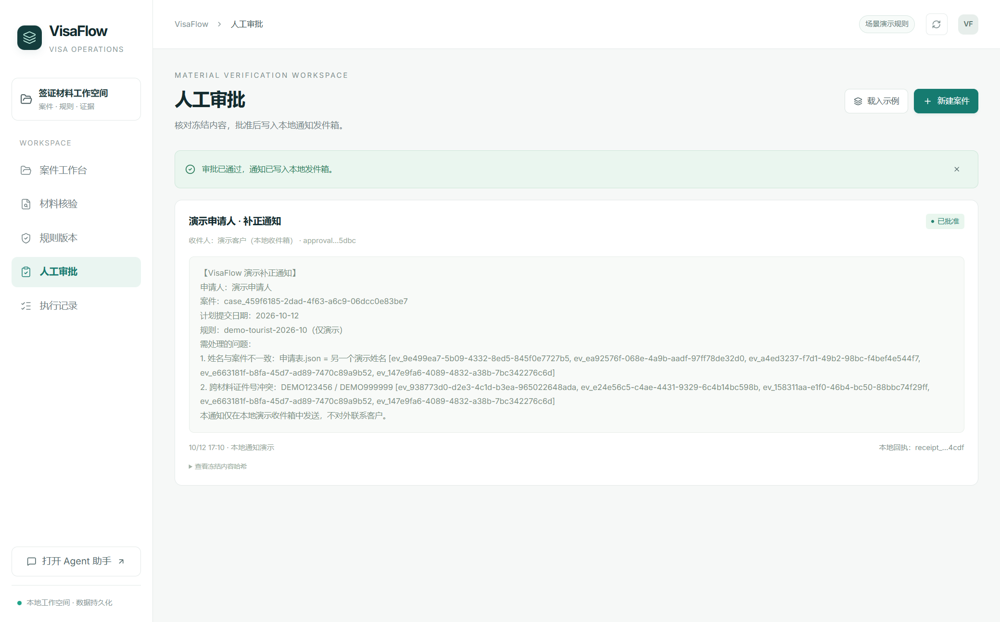
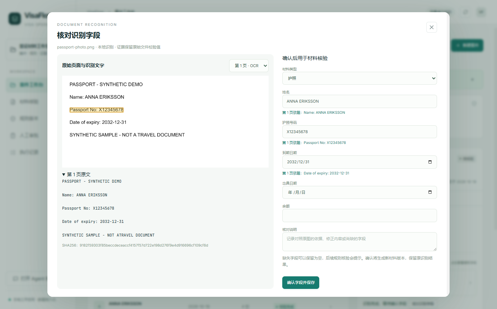

# VisaFlow

VisaFlow 是面向签证材料审查与办理流程的桌面应用，将案件管理、材料核验、证据追溯、模型复核和人工审批集中在一个工作台中。



## 功能

- **案件与材料**：上传 PDF、PNG/JPG、JSON、TXT 或 Markdown，按材料类型管理有效版本。
- **PDF 与护照图片识别**：文字 PDF 直接提取，扫描 PDF 与图片使用本地 OCR；提供页面预览、字段原文定位和人工确认。
- **规则核验**：按计划提交日期选择 Rule Pack，检查材料覆盖、有效日期、姓名与证件号一致性。
- **证据追溯**：检查结果关联证据编号、材料位置与原始摘录，历史材料与任务快照持续保留。
- **审批与恢复**：冻结补正通知的收件人和内容，人工批准或拒绝；SQLite 保存任务、审批、执行记录和本地发件箱回执。
- **模型复核**：配置模型连接后，案件专属 Agent 会话通过 MCP 查询规则、材料和证据。
- **CLI 回放**：批量回放正常、缺材料、证件过期和跨材料冲突样例，检查核验结果与证据引用。

技术栈：Electron、React、TypeScript、Bun、SQLite、WebSocket RPC 和 MCP。

## 快速启动

目前提供 Windows 桌面启动入口。准备：

- Windows 10/11 与 PowerShell。
- Node.js 24 LTS，安装后确认 Node.js 与 npm 可以在终端中使用。
- 首次安装需要网络访问 npm 依赖与 Electron 下载源。

从仓库根目录双击 [启动VisaFlow.cmd](启动VisaFlow.cmd)，或执行：

```powershell
powershell -NoProfile -ExecutionPolicy Bypass -File .\Start-VisaFlow.ps1
```

启动脚本会检查 Bun；未安装时通过 npm 自动准备 Bun，然后安装项目依赖、构建桌面应用并打开窗口。首次安装和构建需要一些时间。

修改源码后重新构建：

```powershell
powershell -NoProfile -ExecutionPolicy Bypass -File .\Start-VisaFlow.ps1 -Rebuild
```

只准备依赖和构建，不打开桌面：

```powershell
powershell -NoProfile -ExecutionPolicy Bypass -File .\Start-VisaFlow.ps1 -NoLaunch
```

启动器按自身目录定位源码与运行数据，从其他工作目录执行也能正确找到应用。应用配置在 `.visaflow-profile/`，案件、材料、核验结果与审批记录在 `data/`；它们会在本机自动创建。

## 三分钟演示

1. 打开案件工作台，点击载入示例，选择材料缺失或字段冲突的案件。
2. 执行核验，查看规则版本、问题列表和证据编号。
3. 点击证据按钮，查看对应的材料来源、字段位置与摘录。
4. 生成补正通知，进入人工审批，查看冻结内容后批准或拒绝。
5. 打开执行记录，查看审批与回执；关闭再打开应用可继续查看保存的案件。
6. 需要模型复核时，在案件专属会话中配置模型连接并发送准备好的复核草稿。

手动上传可使用 [examples](examples) 中的合成材料。操作步骤与当前调用链见 [演示指南](DEMO_GUIDE.md)。





## 工作流

```text
桌面提交材料
  → WebSocket RPC 保存案件与材料版本
  → SQLite 持久化核验任务与材料快照
  → 返回任务 ID，后台执行规则检查
  → 保存证据与 Trace，推送进度事件
  → 页面读取结果并展示证据引用
  → 生成冻结通知，等待人工审批
  → 批准后保存本地发件箱回执
```

规则核验可以独立于模型连接运行。模型复核使用当前案件绑定的工具和证据，人工审批仍在业务界面完成。

演示使用合成材料与两版示例规则；通知写入本地发件箱。PDF/OCR 使用 PDF.js 与 Tesseract.js，本地中英文识别模型随依赖安装，识别材料无需云服务密钥。单文件最大 8 MB，PDF 最多 8 页；识别字段经人工确认后进入核验，未识别出的内容保留为空。复杂银行表格和真实渠道接入可继续扩展。

PDF 与护照图片的完整演示见 [识别样例](examples/ocr/README.md)。更新后首次启动加 `-Rebuild`。



## 验证

在仓库根目录执行：

```powershell
powershell -NoProfile -ExecutionPolicy Bypass -File .\Test-VisaFlow.ps1
```

只运行样例回放：

```powershell
powershell -NoProfile -ExecutionPolicy Bypass -File .\Test-VisaFlow.ps1 -ReplayOnly
```

测试覆盖材料核验、证据引用、审批冻结、防重、重启恢复与 MCP 工具执行/读取边界。已有验证过程与结果见 [验证记录](VALIDATION.md)，工具协议回归见 [工具边界验证](TOOL_BOUNDARY_VALIDATION.md)。

## 目录与文档

| 入口 | 用途 |
| --- | --- |
| [Start-VisaFlow.ps1](Start-VisaFlow.ps1) | Windows 依赖准备、构建与桌面启动 |
| [Test-VisaFlow.ps1](Test-VisaFlow.ps1) | 核心测试与四类 CLI 回放 |
| [业务核心说明](app/packages/visaflow-core/README.md) | 案件、规则、证据、审批与 MCP contract |
| [演示指南](DEMO_GUIDE.md) | 桌面步骤与调用链口述 |
| [变更记录](CHANGES.md) | VisaFlow 业务模块、界面与验证入口 |

源码与依赖锁文件在应用源码目录中。公开仓库保留业务源码、测试、合成材料、文档与演示截图；依赖、构建输出和本机运行配置由启动器在本地生成。

## License

[Apache License 2.0](LICENSE)。版权及第三方通知见 [NOTICE](NOTICE)。
